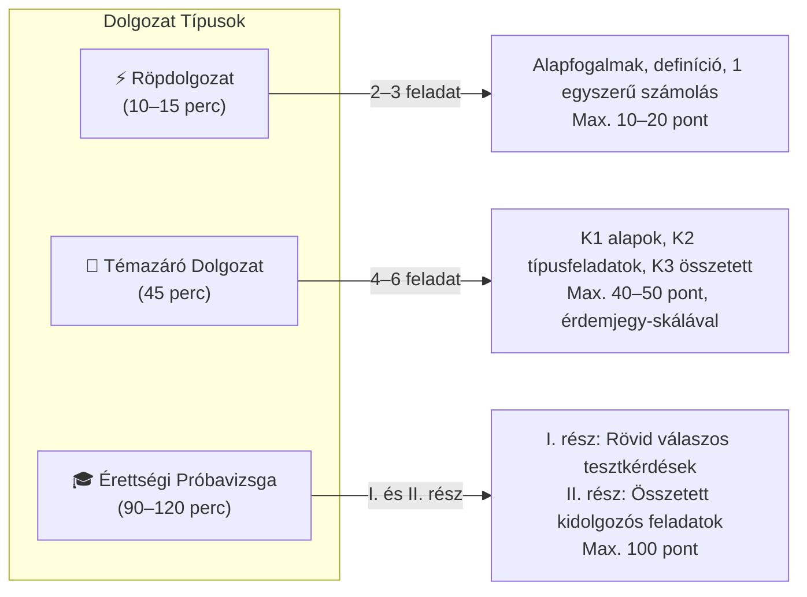
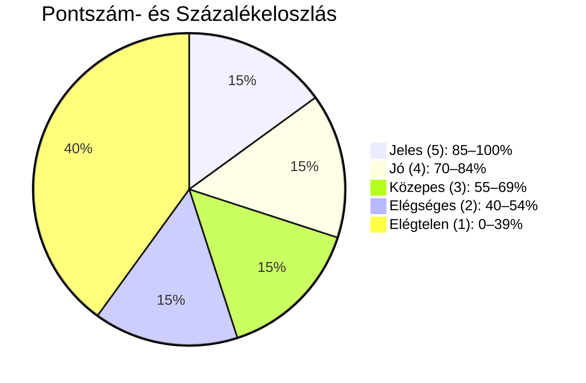
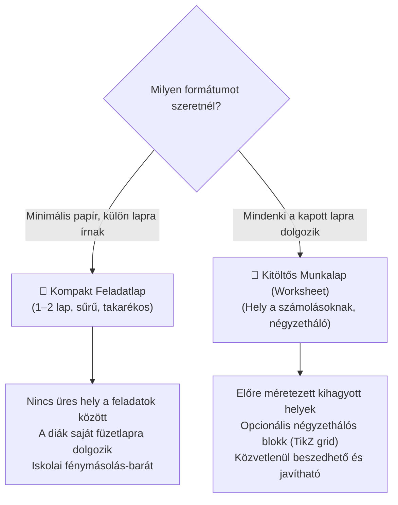
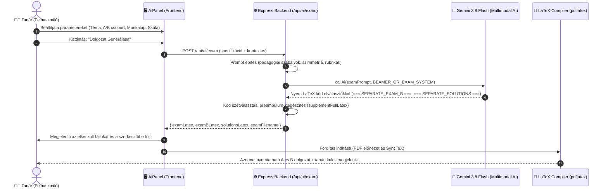

# Dolgozat Generátor (Témazáró, Röpdolgozat & Vizsga) – Részletes Koncepció és Fejlesztési Terv

> **Dokumentum verzió:** 1.0  
> **Dátum:** 2026. november 5.  
> **Célterület:** AI LaTeX Szerkesztő – Középiskolai Dolgozat- és Vizsgagenerálás (Matematika & Fizika)  
> **Célfájl:** `docs/dolgozat_generator_koncepcio_es_fejlesztesi_terv.md`

---

## 📋 Tartalomjegyzék

1. [Vezetői Összefoglaló és Didaktikai Célkitűzés](#1-vezetői-összefoglaló-és-didaktikai-célkitűzés)
2. [Gyakorló Feladatsor vs. Valódi Dolgozat](#2-gyakorló-feladatsor-vs-valódi-dolgozat)
3. [Dolgozat Típusok és Időkeretek](#3-dolgozat-típusok-és-időkeretek)
4. [Dolgozat Sablon & Fejléc Testreszabás](#4-dolgozat-sablon--fejléc-testreszabás)
5. [Csoportok Képzése („A” és „B” csoport) – Valódi Szimmetria](#5-csoportok-képzése-a-és-b-csoport--valódi-szimmetria)
6. [Pontozási Rendszer és Érdemjegy-skála](#6-pontozási-rendszer-és-érdemjegy-skála)
7. [Megoldókulcs és Tanári Segédlet Extra Funkciói](#7-megoldókulcs-és-tanári-segédlet-extra-funkciói)
8. [Elrendezési Módok: Feladatlap vs. Kitöltős Munkalap](#8-elrendezési-módok-feladatlap-vs-kitöltős-munkalap)
9. [Felhasználói Felület (UI) Tervezet az AI Asszisztensben](#9-felhasználói-felület-ui-tervezet-az-ai-asszisztensben)
10. [Rendszerarchitektúra & Munkafolyamat](#10-rendszerarchitektúra--munkafolyamat)
11. [Ütemterv és Implementációs Lépések](#11-ütemterv-és-implementációs-lépések)

---

## 🎯 1. Vezetői Összefoglaló és Didaktikai Célkitűzés

A jelenlegi feladatgeneráló modul kiválóan alkalmas gyakorló feladatsorok és házi feladatok összeállítására. Azonban az iskolai osztálytermi oktatásban a **számonkérés (dolgozatírás)** alapvetően eltérő követelményeket támaszt:
- **Adminisztratív fejléc és azonosítás:** Név, osztály, dátum, csoport és összesítő pontozó táblázat szükséges a lap tetején.
- **Szimmetrikus „A” és „B” változatok:** Azonos nehézségű, azonos logikai felépítésű, de numerikusan és vizuálisan eltérő adatsorok a másolás megakadályozására.
- **Kiszámítható pontozási és osztályozási skála:** Standard magyar érettségi pontozási útmutatóval és testreszabható érdemjegy-határokkal (1–5).
- **Megoldókulcs feladatszöveggel:** A tanári javítókulcsnak önállóan is olvashatónak kell lennie (először a feladat szövege, utána a levezetés és a javítási kulcs).
- **Papírtakarékos / Kétoldalas nyomtatási profil:** A fénymásolás költséghatékonyságához igazított tördelés.

A **Dolgozat Generátor** célja, hogy egyetlen gombnyomással készítsen nyomtatásra kész, professzionális tipográfiájú dolgozatot és hozzá tartozó tanári javítókulcsot.

---

## ⚖️ 2. Gyakorló Feladatsor vs. Valódi Dolgozat

| Szempont | Gyakorló Feladatsor (Jelenlegi) | Dolgozat / Témazáró (Tervezett) |
|---|---|---|
| **Cél** | Begyakorlás, otthoni tanulás | Formális osztálytermi számonkérés, osztályozás |
| **Fejléc** | Cím (`\title`), tantárgy | Névvonal, osztály, dátum, csoport, összesítő pontozó táblázat |
| **Időkeret** | Nem kötött | Szigorú (10p, 45p vagy 90p) |
| **Pontszámok** | Opcionális összesítés | Kötelező részpontozás minden feladat mellett a margón |
| **Érdemjegyek** | Nincs | Százalékos és pontszámos érdemjegy-táblázat (1–5) |
| **Csoportok** | Opcionális egybefüggő szöveg | Szimmetrikus „A” és „B” lapok, külön vagy összefésülve |
| **Hely a számolásra** | Nincs (folyó feladatok) | Választható kitöltős munkalap négyzethálóval/vonalazással |
| **Megoldókulcs** | Szimpla levezetés | Feladatszöveg + részletes levezetés + tipikus tanulói hibák |

---

## ⏱️ 3. Dolgozat Típusok és Időkeretek

Az asszisztensben 3 fő didaktikai dolgozat-típus választható:



### 3.1. Röpdolgozat (5–15 perc)
- **Cél:** Az előző órai anyag vagy egy konkrét definíció azonnali ellenőrzése.
- **Felépítés:** 2–3 feladat (1 db feleletválasztós/igaz-hamis fogalomteszt, 1–2 db egy-két lépéses alapfeladat).
- **Elrendezés:** A4-es lapon kétszer egymás mellett vagy alatt (2 példány egy A4-es lapon a papírtakarékosság miatt).

### 3.2. Órai Témazáró Dolgozat (45 perc)
- **Cél:** Egy teljes fejezet (pl. *Másodfokú egyenletek*, *Kinematika*, *Kombinatorika*) lezárása.
- **Felépítés:** 5–6 feladat K1 $\rightarrow$ K2 $\rightarrow$ K3 piramis nehézségi modell szerint.
- **Összpontszám:** Tipikusan 40–50 pont.
- **Kísérő elemek:** Fejléc, összesítő táblázat, érdemjegy-határok a lap alján.

### 3.3. Érettségi Próbavizsga / Szintfelmérő (90–120 perc)
- **Cél:** Félévi, év végi vagy érettségi próba megmérettetés.
- **Struktúra:**
  - **I. Rész (45 perc):** 10–12 db rövid, fogalmi feladat (max. 30 pont).
  - **II. Rész (75 perc):** 3 db kötelező és 2 db választható összetett feladat (max. 70 pont).
- **Megoldólap:** Külön lapra vagy hivatalos érettségi keretbe dolgozva.

---

## 🎨 4. Dolgozat Sablon & Fejléc Testreszabás

### 4.1. Fejléc mezők és azonosítók
A dolgozat fejlécének testreszabhatónak kell lennie az intézményi igényekhez:
- **Iskola / Intézmény neve:** (opcionális fejléc szöveg, pl. *„Budapesti Fazekas Mihály Gimnázium”*)
- **Tantárgy & Témakör:** pl. *„Matematika Témazáró Dolgozat: Kombinatorika és Valószínűségszámítás”*
- **Azonosító mezők:**
  ```latex
  \noindent
  \textbf{Név:} \underline{\hspace{6.5cm}} \quad
  \textbf{Osztály:} \underline{\hspace{2cm}} \quad
  \textbf{Dátum:} \underline{\hspace{2.5cm}}
  ```
- **Csoport megjelölés:** Kiemelt dobozban a jobb felső sarokban: `„A” CSOPORT` vagy `„B” CSOPORT`.

### 4.2. Összesítő Pontozó Táblázat
A lap tetején vagy végén elhelyezett standard tanári javító táblázat:
```latex
\begin{center}
\renewcommand{\arraystretch}{1.4}
\begin{tabular}{|l|c|c|c|c|c|c||c||c|}
\hline
\textbf{Feladat} & \textbf{1.} & \textbf{2.} & \textbf{3.} & \textbf{4.} & \textbf{5.} & \textbf{6.} & \textbf{Összesen} & \textbf{Érdemjegy} \\ \hline
\textbf{Max. pont} & 6 & 8 & 8 & 10 & 10 & 8 & \textbf{50} & --- \\ \hline
\textbf{Elért pont} & & & & & & & & \\ \hline
\end{tabular}
\end{center}
```

---

## 👥 5. Csoportok Képzése („A” és „B” csoport) – Valódi Szimmetria

A dolgozatírás elengedhetetlen kelléke a szomszédok közötti másolás megelőzése. Nem elegendő csupán a feladatok sorrendjét felcserélni, mert a diákok azonnal észreveszik a struktúrát.

### 5.1. A szimmetrikus variáció szabályai
Az AI számára előírt szigorú generálási szabályok:
1. **Azonos didaktikai típus és nehézség:** Ha az „A” csoport 3. feladata egy másodfokú paraméteres egyenlet diszkrimináns-vizsgálattal, akkor a „B” csoport 3. feladata is pontosan ugyanilyen elméleti hátterű legyen!
2. **Különböző numerikus adatok:** A számok legyenek eltérőek, de mindkét csoportban szép, „kerek” (egész vagy egyszerű tört) eredmények szülessenek.
3. **TikZ ábrák szimmetriája:** Geometriai és fizikai feladatoknál az ábrák mérete és szögei legyenek permutálva (pl. „A” csoport: háromszög $\alpha = 30^\circ$, $c = 8$; „B” csoport: $\beta = 45^\circ$, $a = 6$).
4. **Feleletválasztós distraktorok:** A helyes válasz betűjele (A/B/C/D) térjen el a két csoportban!

### 5.2. Csoportok elhelyezési stratégiái a kimenetben
A felhasználó 3 elhelyezési mód közül választhat:
- **Egymás után (külön oldalon):** 1–2. oldal: „A” csoport, 3–4. oldal: „B” csoport.
- **Kétoldalas váltakozó (duplex nyomtatáshoz):** Páratlan oldalak: „A”, Páros oldalak: „B”.
- **Két különálló fájl (.tex):** `Kombinatorika_Dolgozat_A.tex` és `Kombinatorika_Dolgozat_B.tex`.

---

## 📊 6. Pontozási Rendszer és Érdemjegy-skála

### 6.1. Részpontszámok megjelenítése a feladatoknál
Minden feladat sorszáma mellett és minden részfeladatnál kötelező feltüntetni a maximális pontszámot:
```latex
\subsection*{2. Feladat \hfill \normalfont\small [Összesen: 8 pont]}
Egy számtani sorozat harmadik tagja 11, a hetedik tagja 27.
\begin{enumerate}[label=\textbf{\alph*)}]
  \item Határozza meg a sorozat első tagját és differenciáját! \hfill \textit{[4 pont]}
  \item Számítsa ki a sorozat első 20 tagjának összegét! \hfill \textit{[4 pont]}
\end{enumerate}
```

### 6.2. Testreszabható Érdemjegy-skála (Grading Scale)
A dolgozat végén vagy az összesítő táblázat alatt automatikusan generált skála:



A felhasználó a felületen kiválaszthatja a kívánt osztályozási rendszert:
1. **Standard magyar középiskolai (alapértelmezett):**
   - $0 - 39\%$ $\rightarrow$ **Elégtelen (1)**
   - $40 - 54\%$ $\rightarrow$ **Elégséges (2)**
   - $55 - 69\%$ $\rightarrow$ **Közepes (3)**
   - $70 - 84\%$ $\rightarrow$ **Jó (4)**
   - $85 - 100\%$ $\rightarrow$ **Jeles (5)**
2. **Szigorúbb / Gimnáziumi emelt skála:** (pl. $0-49\%$ 1-es, $90\%+$ 5-ös)
3. **Pontszám szerinti abszolút határok:** (pl. 50 pontos dolgozatnál: 0–19p: 1, 20–27p: 2, 28–35p: 3, 36–42p: 4, 43–50p: 5).

A LaTeX kódban megjelenő elegáns kiemelt doboz:
```latex
\begin{center}
\footnotesize
\textbf{Értékelési határok:}\quad
0--19 pont: \textbf{1} \quad|\quad
20--27 pont: \textbf{2} \quad|\quad
28--34 pont: \textbf{3} \quad|\quad
35--42 pont: \textbf{4} \quad|\quad
43--50 pont: \textbf{5}
\end{center}
```

---

## 🔑 7. Megoldókulcs és Tanári Segédlet Extra Funkciói

A dolgozatjavítás a tanár számára a legidőigényesebb folyamat. A generált megoldókulcsnak nemcsak a helyes végeredményt kell tartalmaznia, hanem **javítástámogató szakértői rendszerré** kell válnia.

### 7.1. Kötelező elrendezés (Feladatszöveg először!)
Minden feladat megoldása az alábbi egységes formátumot követi:
```latex
\subsection*{2. Feladat – Megoldás és Javítási Útmutató}
\noindent\textbf{A feladat kitűzése:} \textit{Egy számtani sorozat harmadik tagja 11, hetedik tagja 27...}\par\medskip

\noindent\textbf{Részletes levezetés és lépések:}
A számtani sorozat általános tagjának képlete: $a_n = a_1 + (n-1)d$.
\begin{align*}
  a_3 &= a_1 + 2d = 11 \\
  a_7 &= a_1 + 6d = 27
\end{align*}
A két egyenlet különbsége: $4d = 16 \implies d = 4$.
Visszahelyettesítve: $a_1 + 2(4) = 11 \implies a_1 = 3$.

\noindent\textbf{Tételes pontozási útmutató (Rubric):}
\begin{itemize}
  \item Az összefüggések felírása ($a_1 + 2d = 11$ és $a_1 + 6d = 27$): \textbf{2 pont}
  \item A differencia helyes meghatározása ($d = 4$): \textbf{1 pont}
  \item Az első tag helyes meghatározása ($a_1 = 3$): \textbf{1 pont}
  \item \textbf{a) rész összesen: 4 pont}
\end{itemize}
```

### 7.2. Tanári Extra: Tipikus Tanulói Hibák (Distraktorok Elemzése)
A megoldókulcs minden feladat végén tartalmaz egy **„Tanári figyelmeztetés / Tipikus hibák”** bekezdést:
> ⚠️ **Tipikus tanulói tévesztés:** A diákok gyakran összekeverik a differencia képletét és $4d = 16$ helyett osztanak $d = 27/11$-gyel. Részpontszám (1 pont) adható, ha a felírásig eljutott, de a levezetés hibás.

### 7.3. Alternatív Megoldási Útvonalak
Ha egy feladat több logikai úton is megoldható (pl. koordinátageometria vs. tiszta szintetikus euklideszi geometria, vagy szorzattá alakítás vs. megoldóképlet), az AI mindkét utat bemutatja és hozzárendeli a pontokat:
- **1. Megoldási út:** Szorzattá alakítás Viete-formulákkal
- **2. Megoldási út:** Általános megoldóképlet diszkriminánssal

---

## 📐 8. Elrendezési Módok: Feladatlap vs. Kitöltős Munkalap

A dolgozat formátuma alapvetően kétféle lehet a tanár pedagógiai célja szerint:



### 8.1. Kompakt Feladatlap
- Minimális sorközök, 2 oszlopos tördelés opció (`multicol` csomaggal).
- Ideális, ha az iskola papírtakarékos és a diákok saját vonalas/négyzethálós lapot adnak be a megoldásokkal.

### 8.2. Kitöltős Munkalap (Worksheet)
- Minden feladat után automatikus helykihagyás a számoláshoz:
  - Üres kihagyás: `\vspace{4.5cm}`
  - **Valódi négyzethálós mező (TikZ rács):**
    ```latex
    \begin{tikzpicture}
      \draw[step=5mm, gray!35, very thin] (0,0) grid (\linewidth, 4.5);
    \end{tikzpicture}
    ```
  - **Vonalazott mező:** Szöveges kifejtős válaszokhoz pontozott vonalak (`\dotfill`).

---

## 🖥️ 9. Felhasználói Felület (UI) Tervezet az AI Asszisztensben

Az asszisztens fejlécében megjelenik egy új, külön fül: **📝 Dolgozat** (a meglévő Csevegő, Generálás, Átdolgozás, TikZ, Feladatsor, Beamer mellett).

### 9.1. A Dolgozat panel kezelőszervei

```
┌────────────────────────────────────────────────────────┐
│  📝 DOLGOZAT ÉS TÉMAZÁRÓ GENERÁLÁSA                   │
├────────────────────────────────────────────────────────┤
│ Típus:                                                 │
│ [ ⚡️ Röpdolgozat (15p) ] [ 📘 Témazáró (45p) ] [ 🎓 Érettségi ]
│                                                        │
│ Forrás:                                                │
│ [ Egyéni téma ]  [ Aktuális doksi ]  [ Könyvtárfájlok ] │
│                                                        │
│ Témakör: [ Másodfokú egyenletek és egyenlőtlenségek  ] │
│                                                        │
│ Csoportok:                                             │
│ [x] „A” és „B” csoport változat generálása             │
│ Elrendezés: [ Különálló lapokon (egymás után)       ▼] │
│                                                        │
│ Formátum és elrendezés:                                │
│ (o) Kompakt feladatlap (külön lapra dolgoznak)         │
│ ( ) Kitöltős munkalap négyzethálóval a számoláshoz     │
│                                                        │
│ Fejléc adatok:                                         │
│ Iskola/Osztály: [ 10.B ]  Dátum: [ \today            ] │
│ [x] Összesítő pontozási táblázat a lap tetején         │
│                                                        │
│ Értékelés és skála:                                    │
│ [x] Érdemjegy-határok megjelenítése a lap alján        │
│ Skála: [ Standard középiskolai (40% - 55% - 70% - 85%) ▼]
│                                                        │
│ Tanári javítókulcs:                                    │
│ [x] Teljes feladatszöveg minden megoldás előtt         │
│ [x] Tételes pontozási útmutató (Rubric)                │
│ [x] Tipikus tanulói hibák és tévesztések elemzése      │
│ Elhelyezés: [ Különálló megoldókulcs .tex fájlba    ▼] │
├────────────────────────────────────────────────────────┤
│ [ 🚀 Teljes Dolgozat és Megoldókulcs Generálása      ] │
└────────────────────────────────────────────────────────┘
```

---

## 🏗️ 10. Rendszerarchitektúra & Munkafolyamat



---

## 🚀 11. Ütemterv és Implementációs Lépések

A dolgozatgeneráló modul fokozatosan, stabil mérföldkövek mentén vezethető be a meglévő rendszerbe:

### 1. Fázis: Backend Alapok és Sablonmotor
- [ ] Új backend végpont létrehozása: `POST /api/ai/exam` a `backend/routes/ai.js`-ben.
- [ ] Dolgozat fejléc- és táblázatépítő segédfüggvények (`generateExamHeader`, `generateGradingTable`).
- [ ] Szigorú A/B csoport szimmetria prompt szabályok megfogalmazása.
- [ ] A és B csoport elválasztó logikája (`=== SEPARATE_EXAM_B ===`).

### 2. Fázis: Frontend Dolgozat Panel (UI)
- [ ] Új `mode === 'exam'` beillesztése az `AiPanel.jsx` MODES listájába (`GraduationCap` vagy `FileSpreadsheet` ikonnal).
- [ ] Típusválasztó (Röpdolgozat / Témazáró / Érettségi próba).
- [ ] Fejléc beállító mezők (Iskola, Osztály, Dátum, Csoportok).
- [ ] Kitöltős munkalap vs. Kompakt feladatlap kapcsoló.
- [ ] Érdemjegy-skála választó és pontszám kalkulátor.

### 3. Fázis: Tipográfia és Négyzethálós Kitöltő (Worksheet)
- [ ] TikZ négyzethálós mező generáló integrálása a feladatok közé a kitöltős módhoz.
- [ ] Margók és oldalbeállítások finomhangolása (`geometry` csomag: `top=2cm, bottom=2cm, left=1.8cm, right=1.8cm`).
- [ ] Kétoldalas nyomtatási profil támogatása (`twoside`).

### 4. Fázis: Tanári Megoldókulcs és Export
- [ ] Tanári javítókulcs szétválasztása és automatikus mentése:
  - `Témakör_Dolgozat_A.tex`
  - `Témakör_Dolgozat_B.tex`
  - `Témakör_Dolgozat_Megoldasok.tex`
- [ ] Tipikus tanulói hibák (distraktorok) blokk automatikus generálása.
- [ ] Értesítés és egykattintásos váltás az A, B dolgozat és a megoldókulcs között.

---

> **Összegzés:** Ez a koncepció a jelenlegi feladatsor-generátort egy valódi, iskolai környezetben azonnal bevethető **pedagógiai vizsgaközponttá** emeli, amellyel a tanár 1 perc alatt előállíthat egy teljes, hibátlan, professzionálisan tördelt A-B csoportos témazárót a hozzátartozó javítási útmutatóval együtt.
