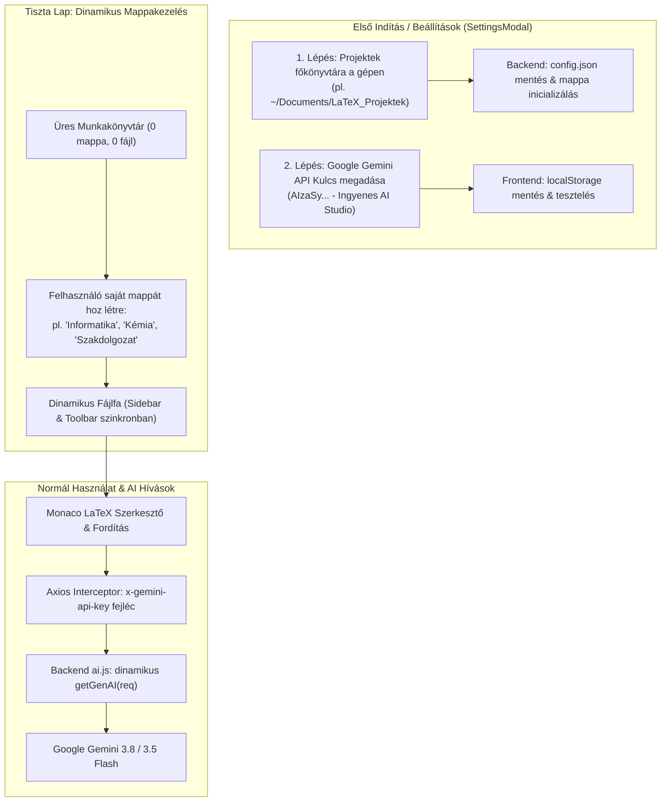

# AI LaTeX Studio – Egyéni Munkakönyvtár, Dinamikus Mappastruktúra és API Kulcs Kezelés (BYOK) Részletes Terve

> **Dokumentum verzió:** 2.0 (Bővített kiadás)  
> **Dátum:** 2026. november  
> **Célterület:** Teljes függetlenítés a hardcoded beállításoktól: saját gép projektek főkönyvtára, tiszta lap (nulláról induló dinamikus mappák a fix Matematika/Fizika helyett), és egyéni Google Gemini API kulcs (BYOK).  
> **Érintett komponensek:** `backend/routes/files.js`, `backend/routes/ai.js`, `backend/server.js`, `frontend/src/components/Sidebar.jsx`, `frontend/src/components/Toolbar.jsx`, `frontend/src/components/AiPanel.jsx`, `frontend/src/components/SettingsModal.jsx`, `frontend/src/App.jsx`, `frontend/src/utils/documentDetector.js`

---

## 🎯 1. Vezetői Összefoglaló és Problémafelvetés

Az **AI LaTeX Studio** eredetileg egy helyi fejlesztői környezetként indult, ahol a beállítások rögzítettek voltak:
1. **Fix projektek mappa:** A backend szigorúan a projekt forráskódja melletti `projektek/` almappába menti a fájlokat. Ha más futtatja a programot a saját gépén, nem tudja kijelölni, hol tárolja a saját dokumentumait (pl. a saját `Dokumentumok/LaTeX_Munkakönyvtár` mappájában, felhős szinkronizált meghajtón vagy külső lemezen).
2. **Beégetett "Matematika" és "Fizika" struktúra:** A rendszer induláskor kötelezően létrehozza a `Matematika` és `Fizika` mappákat, a felső eszköztárban fixen ez a két tantárgygomb szerepel, és a fájlmentés is ide kényszeríti a dokumentumokat. A felhasználók azonban **számtalan más területen** is használni kívánják a rendszert (pl. Informatika, Kémia, Biológia, Történelem, Irodalom, egyetemi jegyzetek, szakdolgozat, pénzügyi elemzések, hivatalos levelek vagy cikkek).
3. **Központi API kulcs kitettség:** A szerver a fejlesztő személyes `.env` kulcsát használja. Más felhasználók bekapcsolódásakor ez azonnal kvótakorlátokba (429 Too Many Requests) és személyes költségekbe ütközik.

### 🌟 A Megoldás 3 Alappillére
- 📁 **Pillér 1 – Konfigurálható Munkakönyvtár (Custom Workspace):** A felhasználó szabadon megadhatja a gépén, hogy hol legyen a projektek főkönyvtára.
- 🗂️ **Pillér 2 – Tiszta Lap és Dinamikus Mappák (Start from Scratch):** Nincsenek beégetett mappák. A felhasználó a nulláról indul, és tetszőleges nevű fő- és almappákat hozhat létre a saját igényei szerint.
- 🔑 **Pillér 3 – Kliensoldali API Kulcs Kezelés (BYOK - Bring Your Own Key):** Bárki a saját ingyenes vagy prémium Google Gemini kulcsával használhatja az AI asszisztenst; a kulcs a böngészőjében marad, és nem szivárog ki a szerverre.

---

## 🏗️ 2. Rendszerarchitektúra és Munkafolyamat



---

## 📂 3. Pillér 1: Projektek Főkönyvtárának Beállítása a Gépen

### 3.1. Probléma és Megoldás
Jelenleg a `backend/routes/files.js` 6. sorában ez szerepel:
```javascript
const PROJECTS_DIR = path.join(__dirname, '..', '..', 'projektek');
```
Ez egy merev, relatív útvonal. Az új megoldásban a főkönyvtár elérési útja dinamikusan konfigurálható.

### 3.2. Konfigurációs Perzisztencia (`backend/data/config.json`)
A backend egy külön konfigurációs fájlban tárolja a helyi gép beállításait:
```json
{
  "projectsRootDirectory": "/Users/felhasznalo/Documents/LaTeX_Projektek",
  "configuredAt": "2026-11-03T19:30:00.000Z",
  "allowServerKeyFallback": true
}
```

### 3.3. Új Backend Konfigurációs Végpontok (`backend/routes/config.js`)
- `GET /api/config`: Visszaadja a jelenlegi konfigurációt (aktív munkakönyvtár útvonala, írható-e, létezik-e).
- `POST /api/config/workspace`: Új munkakönyvtár beállítása:
  - Ellenőrzi, hogy az útvonal érvényes abszolút útvonal-e.
  - Ha a mappa nem létezik, automatikusan létrehozza (`fs.ensureDir`).
  - Ellenőrzi az írási és olvasási jogosultságot egy átmeneti fájl létrehozásával és törlésével.
  - Elmenti a `config.json`-be és frissíti a futó szerver memóriabeli `activeProjectsDir` változóját.
- `POST /api/config/browse-native` (opcionális helyi macOS/Linux segéd): Natív rendszermappa-választó ablak megnyitása (`osascript` Macen), vagy közvetlen útvonal-beillesztés támogatása.

---

## 🗂️ 4. Pillér 2: Tiszta Lap és Dinamikus Mappastruktúra (Nulláról Indítás)

### 4.1. A fix "Matematika" és "Fizika" megszüntetése
A forráskódból kivezetjük a hardcoded feltételezéseket:
1. **Nincs automatikus könyvtárgenerálás:** A backend nem hoz létre se `Matematika`, se `Fizika` mappát magától.
2. **Üres állapot támogatása (Clean Slate):** Ha a kiválasztott munkakönyvtár üres, a rendszer nem omlik össze, hanem egy elegáns, informatív kezdőképernyőt mutat:
   - *"A munkakönyvtárad jelenleg üres. Hozz létre egy új mappát vagy egy üres dokumentumot a kezdéshez!"*
   - Egyértelmű `+ Új mappa létrehozása` gomb közvetlenül a Sidebar közepén.
3. **Bármilyen tantárgy vagy célterület:** A felhasználó saját kategóriákat alakít ki:
   - Iskolai tantárgyak: *Informatika, Kémia, Biológia, Földrajz, Magyar nyelv és irodalom, Történelem*
   - Egyetem / Kutatás: *Analízis III, Kvantummechanika, Szakdolgozat, Konferencia cikkek*
   - Munka / Egyéni: *Projekt tervek, Szerződések, Pénzügyi kimutatások, Hivatalos levelek, Önéletrajzok*
4. **Meglévő fájlok és könyvtárak 100%-os megőrzése:** A jelenlegi környezetben lévő meglévő anyagaidat (`projektek/Matematika/`, benne a `Gráfok.tex`, `Kombinatorika/`, `Exponenciális egyenletek.tex` stb.) a rendszer **soha nem törli**! Az új dinamikus fájlkezelő azonnal felismeri és beolvassa a meglévő mappákat és fájlokat, így minden korábbi munkád azonnal elérhető marad.

### 4.2. Dinamikus Fájlfa és Sidebar (`Sidebar.jsx`)
- A Sidebar nem két fix ágat (`tree.Matematika` és `tree.Fizika`) jelenít meg, hanem rekurzívan bejárja a munkakönyvtárban lévő **összes létező mappát**.
- Minden gyökérmappa mellett megjelenik az új almappa készítése (`FolderPlus`), átnevezése (`Pencil`) és törlése (`Trash2`).
- A felhasználó közvetlenül a gyökérben is hozhat létre új mappát a Sidebar fejlécében található `+ Új kategória / mappa` gombbal.

### 4.3. Dinamikus Toolbar Kategóriaválasztó (`Toolbar.jsx`)
A jelenlegi fix gombok helyett:
```jsx
{/* RÉGI (Hardcoded): */}
<button className="subject-btn active">Matematika</button>
<button className="subject-btn">Fizika</button>
```
Egy **Dinamikus Kategória / Mappaválasztó** lép életbe:
- Egy elegáns `CustomSelect` vagy rugalmas tabsáv, amely kilistázza a munkakönyvtár létező gyökérmappáit.
- Tartalmaz egy `+ Új kategória hozzáadása...` elemet, amellyel 1 másodperc alatt létrehozható egy új téma.
- Ha a felhasználó megnyit egy dokumentumot egy almappából (pl. `Informatika/Python_alapok.tex`), a Toolbar automatikusan az adott mappa nevét és témáját veszi fel.

### 4.4. Rugalmas Mentés és Dokumentumfelismerés (`documentDetector.js` & `files.js`)
- **Célmappa intelligens kijelölése:** Mentéskor a rendszer elsődlegesen az **éppen nyitott dokumentum mappájába** vagy a **Toolbaron kiválasztott aktív kategóriába** ment.
- Ha még egyetlen mappa sincs létrehozva, felajánlja a közvetlen gyökérbe mentést VAGY automatikusan megkérdezi a kívánt kategórianevet.
- A `documentDetector.js` nem kényszeríti rá a "Matematika" feliratot minden fájlra, hanem a fájl címét és kulcsszavait általános témacímkékké alakítja.

---

## 🔑 5. Pillér 3: Kliensoldali API Kulcs Kezelés (BYOK)

### 5.1. Adatáramlás és Biztonság (Zero-Leakage)
- A felhasználó a böngészőjében adja meg a személyes Google Gemini API kulcsát (`AIzaSy...`).
- A kulcs a böngésző `localStorage` tárhelyében tárolódik (`ai_latex_gemini_api_key`).
- **Axios Interceptor:** Minden `/api/ai/*` végpontra irányuló kérés fejlécébe beilleszti a `x-gemini-api-key: <kulcs>` mezőt.
- **Backend működés:** A szerver a kérésből kinyert kulccsal példányosítja a `GoogleGenerativeAI(key)` objektumot. A kérés lezárultával a kulcs törlődik a memóriából; semmilyen naplófájlba és lemezre nem íródik ki.

### 5.2. Végpont-ellenőrzés (`POST /api/ai/validate-key`)
A beállítási ablakban a felhasználó nemcsak elmenti a kulcsot, hanem azonnal le is tudja tesztelni:
- A backend egy 1-tokenes, villámgyors ellenőrzést hajt végre a `gemini-3.5-flash-lite` modellel.
- Sikeres válasz esetén azonnali vizuális megerősítés (zöld pipa, elérhető Gemini modellek listája).
- Hibás kulcs vagy 429 kvótatúllépés esetén tiszta, emberi hibaüzenet jelenik meg.

---

## 🎛️ 6. Beállítások és Első Indítási Varázsló (`SettingsModal.jsx`)

Egy egyesített, prémium vezérlőpult, amely egyetlen helyen oldja meg a munkakönyvtár és az API kulcs kezelését:

```
+-----------------------------------------------------------------------+
|  ⚙️ AI LaTeX Studio – Beállítások & Munkakörnyezet                    |
+-----------------------------------------------------------------------+
|                                                                       |
|  📁 1. PROJEKTEK FŐKÖNYVTÁRA A GÉPEN                                  |
|  Hol szeretnéd tárolni a LaTeX dokumentumaidat és mappáidat?          |
|  +-----------------------------------------------------+ +---------+  |
|  | /Users/kovacs/Documents/LaTeX_Projektek             | | Módosít |  |
|  +-----------------------------------------------------+ +---------+  |
|  ✅ Mappa elérhető és írható. (Jelenleg 0 mappa, tiszta lap)          |
|                                                                       |
|  -------------------------------------------------------------------  |
|                                                                       |
|  🔑 2. GOOGLE GEMINI API KULCS (BYOK)                                 |
|  Add meg a saját kulcsodat az AI generáláshoz és hibajavításhoz.      |
|  +-----------------------------------------------------+ +---------+  |
|  | AIzaSyB************************************       👁 | | Törlés  |  |
|  +-----------------------------------------------------+ +---------+  |
|  [ 🔍 Kulcs tesztelése ] -> 🟢 Érvényes! Csatlakozva: Gemini 3.8 Flash|
|                                                                       |
|  💡 Nincs még kulcsod? Ingyenes beszerzés 1 perc alatt:               |
|  👉 [Google AI Studio – Get API Key (Kattints ide)]                  |
|                                                                       |
|  -------------------------------------------------------------------  |
|                                                                       |
|  [ Mégse ]                                           [ Mentés és Kész]|
+-----------------------------------------------------------------------+
```

---

## 💻 7. Technikai Kódrészletek és Módosítási Terv

### 7.1. Dinamikus `files.js` – Fix Matematika/Fizika Eltávolítása
A `backend/routes/files.js` fájlban:
```javascript
// A rögzített path.join helyett konfigurációból olvasott útvonal
const getProjectsDir = () => {
  return global.APP_CONFIG?.projectsRootDirectory || path.join(__dirname, '..', '..', 'projektek');
};

// GET /api/files/projects
router.get('/projects', async (req, res) => {
  try {
    const projectsDir = getProjectsDir();
    await fs.ensureDir(projectsDir);

    const metadata = await loadMetadata();
    const entries = await fs.readdir(projectsDir);
    
    // Nem fix Matematika/Fizika objektum, hanem dinamikus fa!
    const tree = {};
    const allTagsMap = {};

    for (const entry of entries) {
      if (entry.startsWith('.')) continue;
      const entryPath = path.join(projectsDir, entry);
      const stat = await fs.stat(entryPath);
      
      if (stat.isDirectory()) {
        const scanned = await scanDirectory(entryPath, entry, metadata, allTagsMap);
        tree[entry] = {
          name: entry,
          path: entryPath,
          relativePath: entry,
          subject: entry,
          isFolder: true,
          folders: scanned.folders,
          files: scanned.files,
          totalCount: scanned.totalCount
        };
      }
    }

    res.json({ success: true, tree, tags: allTagsMap, workspacePath: projectsDir });
  } catch (err) {
    res.status(500).json({ error: err.message });
  }
});
```

### 7.2. Dinamikus Kategória Létrehozás a Gyökérben
```javascript
// POST /api/files/folder/create
router.post('/folder/create', async (req, res) => {
  try {
    const { parentPath, folderName } = req.body;
    const projectsDir = getProjectsDir();

    const cleanName = folderName.trim().replace(/[^a-zA-Z0-9áéíóöőúüűÁÉÍÓÖŐÚÜŰ _\-().]/g, '_');
    const targetParent = parentPath ? path.resolve(parentPath) : projectsDir;

    // Path traversal védelem: szigorúan a projektek mappán belül kell maradni
    if (!targetParent.startsWith(path.resolve(projectsDir))) {
      return res.status(403).json({ error: 'Hozzáférés megtagadva' });
    }

    const newFolderPath = path.join(targetParent, cleanName);
    if (await fs.pathExists(newFolderPath)) {
      return res.status(400).json({ error: `Már létezik "${cleanName}" nevű mappa!` });
    }

    await fs.ensureDir(newFolderPath);
    res.json({ success: true, path: newFolderPath, name: cleanName });
  } catch (err) {
    res.status(500).json({ error: err.message });
  }
});
```

### 7.3. Dinamikus AI Kliens (`backend/routes/ai.js`)
```javascript
const getGenAI = (req) => {
  // Szigorúan a felhasználó kéréséből érkező egyéni kulcs használata (tiszta BYOK)
  const clientKey = req?.headers?.['x-gemini-api-key'] || req?.body?.apiKey;

  if (!clientKey || !clientKey.trim()) {
    const err = new Error('Nincs beállítva Gemini API kulcs! Kérjük, add meg a Beállításokban a saját kulcsodat.');
    err.status = 401;
    throw err;
  }
  return new GoogleGenerativeAI(clientKey.trim());
};
```

---

## 🔒 8. Biztonsági, Jogosultsági és Helyi Fájlrendszer Irányelvek

> [!CAUTION]
> ### 🛡️ Szigorú Adatvédelmi Szabály: Meglévő Könyvtárak és Fájlok Érinthetetlensége (Zero Data Loss)
> Az implementáció során **SZIGORÚAN TILOS bármely meglévő könyvtárat vagy dokumentumot törölni, áthelyezni vagy felülírni!**
> - A projekt jelenlegi `projektek/` mappájában lévő összes meglévő anyag (`projektek/Matematika/`, `projektek/Fizika/`, benne a `Kombinatorika/`, `Gráfok.tex`, `Exponenciális egyenletek.tex` és minden egyéb fájl) **maradéktalanul megmarad**.
> - A "nulláról indulás" elve kizárólag arra vonatkozik, hogy a rendszer **nem kényszeríti rá** az új felhasználókra vagy egy újonnan kijelölt üres munkakönyvtárra a hardcoded mappákat; viszont a már létező mappákat az új dinamikus fájlfa azonnal, hiba és veszteség nélkül beolvassa és megjeleníti.
> - A jelenlegi környezetben az alapértelmezett munkakönyvtár automatikusan a meglévő `projektek/` mappa marad, így a felhasználó korábbi munkái változatlanul elérhetőek lesznek.

1. **Path Traversal védelem:** A felhasználó által megadott mappa- és fájlnevek nem léphetnek ki a kijelölt `projectsRootDirectory` határain kívülre (`..` vagy szimbolikus linkek blokkolása).
2. **Írási jogosultság ellenőrzése:** Amikor a felhasználó kiválasztja a munkakönyvtárat, a backend azonnal ellenőrzi, hogy a Node.js folyamat képes-e írni az adott könyvtárba. Ha nem (pl. védett rendszermappa), figyelmeztetést ad, és másik mappa kijelölését kéri.
3. **API kulcs védelme:** Az egyéni API kulcsot semmilyen körülmények között nem logoljuk a konzolra vagy naplófájlokba, és soha nem írjuk ki a szerver merevlemezére.

---

## 📅 9. Lépésről Lépésre Ütemterv (Roadmap)

| Fázis | Feladat | Érintett Fájlok | Becsült Idő |
|---|---|---|---|
| **1. Fázis: Konfiguráció & Munkakönyvtár** | `config.js` végpontok, `config.json` perzisztencia, konfigurálható `getProjectsDir()` | `backend/routes/config.js`, `backend/server.js` | 1-2 óra |
| **2. Fázis: Fix Matematika/Fizika Törlése** | Dinamikus rekurzív faszerkezet a backendben, üres mappa támogatás | `backend/routes/files.js` | 1 óra |
| **3. Fázis: Beállítások és Varázsló UI** | `SettingsModal.jsx` elkészítése (Munkakönyvtár és API kulcs egy helyen) | `frontend/src/components/SettingsModal.jsx` | 2 óra |
| **4. Fázis: Sidebar & Toolbar Dinamizálás** | Üres állapot nézet, dinamikus kategóriaválasztó a fix gombok helyett, új mappa gomb a gyökérhez | `frontend/src/components/Sidebar.jsx`, `frontend/src/components/Toolbar.jsx` | 2 óra |
| **5. Fázis: BYOK API Kulcs & Interceptor** | Axios interceptor, `validate-key` végpont, kulcs állapotjelzők a fejlécben | `frontend/src/utils/apiKeyManager.js`, `backend/routes/ai.js` | 1 óra |
| **6. Fázis: Univerzális Témakezelés** | `documentDetector.js` és AI promptok tantárgy-függetlenné tétele | `frontend/src/utils/documentDetector.js`, `backend/routes/ai.js` | 1 óra |

---

## 📖 10. Felhasználói Útmutató az Első Indításhoz

Amikor egy új felhasználó elindítja a programot:
1. **Munkakönyvtár megadása:** Kiválasztja a saját gépén, hogy hová mentsen a program (pl. `/Users/nev/Documents/LaTeX_Anyagok`).
2. **Kategóriák kialakítása:** Létrehozza a saját első mappáit az igényei szerint (pl. *Kémia*, *Informatika*, *Történelem*, *Szakdolgozat* stb.).
3. **Saját API kulcs megadása:** Beilleszti a Google AI Studio-ból igényelt ingyenes kulcsát, megnyomja a "Tesztelés" gombot, és azonnal megkezdi a LaTeX dokumentumok készítését.

> [!TIP]
> Ezzel a bővítéssel az AI LaTeX Studio egy specifikus helyi segédeszközből egy univerzális, bárki által testreszabható, professzionális LaTeX munkakörnyezetté lép elő!