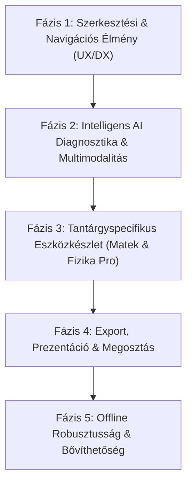

# AI LaTeX Studio – Részletes Fejlesztési Terv (Roadmap)

Ez a dokumentum az **AI LaTeX Studio** (v3.8) jövőbeli fejlesztési irányait, mérföldköveit és technikai megvalósítási tervét rögzíti, kiemelt hangsúlyt fektetve a középiskolai és egyetemi **Matematika** és **Fizika** tananyag-készítés támogatására.

---

## 📌 Jelenlegi Állapot és Legújabb Eredmények (v3.8)

A rendszer alapjai stabilak és működőképesek:
- ✅ **Google Gemini 3.8 Flash** integráció a legfrissebb felhőalapú intelligenciával.
- ✅ **Egységes prémium UI:** Dark glassmorphism téma, modern Lucide SVG ikonrendszer, egyedi komponensek (`CustomSelect`, stepper, gombok).
- ✅ **Közvetlen kódbeillesztés & auto-fordítás:** A generált AI tartalom azonnal a szerkesztőbe kerül és másodpercek alatt TeX Live (pdflatex) PDF-fé fordul.
- ✅ **Intelligens kijelölés-átdolgozás:** Lebegő eszköztár és `⌘K` gyorsbillentyű a kijelölt LaTeX kódrészletek célzott módosításához.
- ✅ **1-Kattintásos Automatikus Mentés:** Tartalmi analízis alapján a rendszer kinyeri a dokumentum címét és automatikusan kategorizál (**Matematika** vs **Fizika**), elkerülve a felesleges felugró ablakokat.
- ✅ **Gyorsbillentyűk:** `⌘S` / `Ctrl+S` egyidejű mentés és fordítás.
- 🔒 **Védett komponensek:** A tűzgömb és a részecskefizika szimuláció stabilitása érintetlen és zárolt.

---

## 🗺️ Fejlesztési Mérföldkövek és Fázisok

---

### 🚀 1. FÁZIS: Szerkesztési és Navigációs Élmény (UX/DX Finomítások)
*Cél: A kódolási és navigációs sebesség maximalizálása nagy dokumentumok esetén.*

1. ✅ **SyncTeX Kétirányú Szinkronizáció (Elkészült v3.9):**
   - **Kódból PDF-be (Forward Search):** Kódra `Ctrl+Click` / `Cmd+Click`-re, `Alt+S`-re vagy az "Ugrás a PDF-re" gombra a PDF előnézet azonnal a megfelelő bekezdésre ugrik, és fénylő kiemeléssel jelzi a helyét.
   - **PDF-ből Kódba (Inverse Search):** A PDF egy bekezdésére duplán kattintva a Monaco szerkesztő pontosan a megfelelő forrássorra görget és kék fénysávval kiemeli.
2. ✅ **Dokumentum Szerkezeti Fa (Outline / Mini-TOC) (Elkészült v3.9):**
   - Lenyitható panel, amely valós időben mutatja a fejezeteket (`\part`, `\chapter`, `\section`, `\subsection`), diákat (`\frametitle`), és definíciókat/tételeket/TikZ ábrákat.
   - Beépített gyorskeresővel és 1-kattintásos gyorsugrással, amely mind a Monaco kódsort, mind a PDF nézetet azonnal odanavigálja.
3. ✅ **Egyéni Preambulumok & Mester-Sablonok Kezelője (Elkészült v3.9):**
   - Felhasználói saját preambulumok és sablonok létrehozása, szerkesztése, törlése és perzisztens tárolása.
   - 1-kattintásos beolvasás a jelenlegi forráskódból.
   - Szigorúan rögzített preambulumos AI generálás, garantáltan egységes betűtípusokkal, csomagokkal és dobozstílusokkal.
4. ✅ **TOC & Dokumentum Szerkezet és Számozások Intelligens Javítása (Elkészült v3.9.5):**
   - 1-kattintásos gyorsgomb a szerkesztő fejlécében és a Vázlat (TOC) panelben.
   - Átvizsgálja a dokumentum fejezethierarchiáját, javítja a kihagyott vagy hibás szakaszszinteket (`\section`, `\subsection`, `\subsubsection`).
   - Kiszűri a zavaró kettős kézi számozást a címekből (pl. `\section{1. Bevezetés}` → `\section{Bevezetés}`), így a beépített `\tableofcontents` tiszta és szabványos lesz.
   - A matematikai képleteket, magyarázatokat és TikZ ábrákat szigorúan érintetlenül hagyja.
   - Összefoglaló modális ablakkal mutatja a végrehajtott korrekciókat és azonnali 1-kattintásos visszavonási lehetőséget kínál.
5. **LaTeX Snippet Autocomplete:**
   - Gyakori matematikai és fizikai blokkok gyorsbeillesztése tabulátorral:
     - `\begin{align*} ... \end{align*}`
     - `\begin{tcolorbox}[title=...] ... \end{tcolorbox}`
     - `\begin{tikzpicture} ... \end{tikzpicture}`
     - `\begin{enumerate}[(a)] ... \end{enumerate}`
4. **Verziótörténet & Mentési Pillanatképek (Snapshot History):**
   - Helyi visszavonási előzmények (Session History).
   - Lehetőség visszaállni a dokumentum 10 perccel vagy 1 órával korábbi állapotára.

---

### 🧠 2. FÁZIS: Intelligens AI Diagnosztika és Multimodalitás
*Cél: Az ember-AI együttműködés súrlódásmentessé tétele hiba esetén és képi forrásoknál.*

1. ✅ **"Fix with AI" – 1-Gombos Fordítási Hibajavító (Elkészült v3.9):**
   - Ha a `pdflatex` hibával leáll (pl. hiányzó `}`, elírt parancs, hiányzó `$` zárás), a konzol tetején és fejlécében megjelenik a pulzáló *"Hiba javítása AI-val"* gomb és hibasáv.
   - A rendszer elküldi a hibaüzenetet és a hibás kódot a Gemini 3.8 Flash-nek, ami azonnal kijavítja a szintaxishibát, frissíti a szerkesztőt, és automatikusan újrafordítja a PDF-et.
2. **Kézírás & Táblakép → TikZ/LaTeX Átalakítás (Fejlett Vision API):**
   - Telefonnal fotózott kézzel rajzolt fizikai ábrák (pl. lejtő, rugó, optikai sugármenet) közvetlen vektoros TikZ kóddá alakítása.
   - Kézzel írt matematikai levezetések fotójának tiszta LaTeX egyenletsorrá alakítása.
3. ✅ **Interaktív AI Szerkesztő Csevegő & Multimodális Kép-alapú Hibajavítás (Elkészült v3.9):**
   - Interaktív párbeszédes AI Csevegő az AI panelen, amely valós időben ismeri az aktív LaTeX dokumentumot (`currentCode`).
   - Kérdések és feladatok: *"Bővítsd ki a 3. feladatot egy nehezebb alfeladattal"*, *"Generálj hozzá pontozási útmutatót"*.
   - **Vágólapos Képbeillesztés (`⌘V` / `Ctrl+V`):** A felhasználó egyszerűen beillesztheti a vágólapról a lefordított PDF képernyőképét vagy hibás matematikai ábráját.
   - **Vizuális hibaelemzés & 1-kattintásos kódakciók:** A Gemini 3.8 Flash elemzi a csatolt képet és a LaTeX kódot, azonosítja az elrendezési/formázási hibát, és közvetlenül beilleszthető kódkártyákat ad át ("Másolás", "Beillesztés a kódba & Fordítás", "Teljes kód cseréje & Fordítás").
   - Képnagyító lightbox és előnézeti sáv a küldés előtt.
4. **LaTeX Képletsegéd (Természetes nyelv → Képlet):**
   - Prompt: *"Írd be a gravitációs vonzóerő képletét és a potenciális energiát"* $\rightarrow$ azonnal generálja és beilleszti:
     $$F = G \frac{m_1 m_2}{r^2}, \quad E_{\text{pot}} = -G \frac{m_1 m_2}{r}$$

---

### 📐 3. FÁZIS: Tantárgyspecifikus Eszközkészlet (Matematika & Fizika Pro)
*Cél: Speciális magyar oktatási igények kiszolgálása.*

1. **Intelligens Didaktikai Feladatgenerátor (Részletes terv: [feladatgenerator_fejlesztesi_terv.md](feladatgenerator_fejlesztesi_terv.md)):**
   - Létező `.tex` dokumentum elméleti anyagához (vagy kijelölt tételéhez) illeszkedő feladatgenerálás.
   - Fokozatosan nehezedő szintek (Piramis modell: Alapozó $\to$ Középszint $\to$ Emelt szint $\to$ Verseny).
   - Feladattípusok variációja: számolásos, feleletválasztós (A/B/C/D), "Keresd a hibát!", gyakorlati életszerű, scaffolded részfeladatok.
   - Magyar érettségi stílusú tételes pontozási útmutató (rubric) és tanári/diák kidolgozási nézet.
   - Rugalmas beillesztés: új dokumentumként VAGY a jelenlegi fájl végére hozzáfűzve (`\section{Gyakorló feladatsor}`).
2. **Magyar Érettségi Feladatsor Sablon és Pontozó:**
   - Hivatalos Oktatási Hivatal stílusú fejlécek (név, osztály, dátum, elérhető pontszám).
   - Pontozási útmutató és megoldókulcs automatikus lábjegyzetté vagy külön lapra generálása.
3. **TikZ Vizuális Ábragyűjtemény (Beépített komponensek):**
   - Gyakori fizikai és matematikai ábrák parametrikus beszúrása:
     - Koordináta-rendszerek függvénygrafikonokkal (másodfokú, szinusz, exponenciális).
     - Fizikai kísérletek: szabadesés, inga, elektromos kapcsolások (`circuitikz`).
     - Geometriai ábrák: háromszögek beírt/köréírt köre, Pitagorasz-ábra.
4. **Fizikai Mértékegység és Képletellenőrző:**
   - Az `siunitx` csomag integrált támogatása (pl. `\SI{9.81}{\meter\per\second\squared}`).
   - Jelölésbeli egységesség ellenőrzése az egész dokumentumban.

---

### 📤 4. FÁZIS: Export, Prezentáció és Megosztás
*Cél: A dokumentumok könnyű publikálása és bemutatása.*

1. **Beépített Beamer Prezentációs Mód:**
   - Ha a dokumentum Beamer sablon, a PDF előnézetből egyetlen gombbal teljes képernyős diavetítés indítható.
2. **Közvetlen Képexport (TikZ $\rightarrow$ PNG / SVG):**
   - Különálló ábrák kiexportálása prezentációkba vagy feladatlapokba való beillesztéshez.
3. **Összevont Csomagkezelő (Package Doctor):**
   - Ha a felhasználó egy olyan LaTeX csomagot használ, ami hiányzik a lokális TeX Live telepítésből, a rendszer figyelmeztet és megadja a `tlmgr install <csomag>` parancsot.
4. **Egyéni Munkakönyvtár, Dinamikus Mappastruktúra és API Kulcs Kezelés (BYOK) (Részletes terv: [egyeni_api_kulcs_kezeles_terv.md](egyeni_api_kulcs_kezeles_terv.md)):**
   - **Munkakönyvtár a gépen:** A felhasználó maga adhatja meg, hogy hol legyen a projektek főkönyvtára a számítógépén.
   - **Tiszta lap (Start from Scratch):** A fixen beégetett "Matematika" és "Fizika" mappák és gombok megszüntetése; a rendszer üres munkakönyvtárból indul, a felhasználó maga hozza létre a saját tantárgyi, tudományos vagy egyéni kategóriáit (pl. Kémia, Informatika, Történelem, Szakdolgozat, Cikkek).
   - **BYOK API Kulcs:** Saját Google Gemini kulcs megadása `localStorage` tárolással és automatikus Axios kérés-fejléc interceptorral (`x-gemini-api-key`), zéró szerveroldali adatszivárgással.
   - **Beállítások & Indítási Varázsló (`SettingsModal.jsx`):** Egyesített vezérlőpult a mappa és az API kulcs azonnali teszteléséhez és beállításához.

---

### 🛡️ 5. FÁZIS: Offline Működés és Stabilitás
*Cél: Függetlenség a hálózattól és gyorsítótárazás.*

1. **Helyi LLM (LM Studio / Ollama) finomhangolás:**
   - Képes legyen teljes offline módban, internetkapcsolat nélkül is magas minőségű LaTeX kódot generálni.
2. **Gyorsított Háttérfordítás (Background Cache):**
   - Részleges fordítás nagy könyveknél/jegyzeteknél (fejezetenkénti `\includeonly` gyorsítás).

---

## 📅 Javasolt Ütemezési Sorrend (Prioritási Mátrix)

| Feladat | Becsült Idő | Hatás | Prioritás |
|---------|-------------|-------|-----------|
| **"Fix with AI" Fordítási hibajavító gomb** | 1 nap | 🟢 Nagyon magas | 🔴 P0 (Azonnali) |
| **LaTeX Snippet & környezet kiegészítő** | 1-2 nap | 🟢 Nagyon magas | 🔴 P0 |
| **Magyar Érettségi Sablon & Pontozókulcs generálás** | 2 nap | 🟡 Magas | 🟠 P1 |
| **TikZ Képgenerálás és beépített ábrakönyvtár** | 3 nap | 🟡 Magas | 🟠 P1 |
| **Egyéni API Kulcs Kezelés (BYOK)** | 1 nap | 🟢 Nagyon magas | 🔴 P0 / P1 |
| **SyncTeX kétirányú kattintás (Kód $\leftrightarrow$ PDF)** | 3-4 nap | 🟡 Magas | 🟡 P2 |
| **Dokumentum Szerkezeti Fa (TOC navigátor)** | 2 nap | ⚪ Közepes | 🟡 P2 |
| **Teljes Képernyős Beamer Diabemutató** | 1 nap | ⚪ Közepes | 🟢 P3 |

---

### ✅ Elkészült Új Funkció: PDF TikZ Ábra AI Szerkesztő és Gyorsválasztó

A renderelt PDF előnézetben elérhetővé vált a TikZ ábrák kényelmes, vizuális AI szerkesztése:
1. **Intelligens TikZ Blokkfelismerés (`latexBlockFinder.js`):**
   - Amikor a felhasználó a PDF-en egy ábrára kattint vagy területet jelöl ki körülötte, a rendszer automatikusan és tisztán a teljes `\begin{tikzpicture} ... \end{tikzpicture}` környezetet azonosítja be (a környező `figure` vagy `center` burkolóval együtt), megszüntetve a korábbi töredékes `\node` vagy `\draw` kijelöléseket.
2. **Közvetlen Ábragyorsválasztó Sáv (`PdfPreview.jsx`):**
   - A PDF fejlécébe bekerült az **Ábrák** gomb dinamikus számláló jelvénnyel (pl. `Ábrák [13]`).
   - Bekapcsolásakor egy elegáns gyorsválasztó sáv jelenik meg a PDF felett, ahol 1 kattintással kiválasztható a dokumentum bármelyik észlelt ábrája sorszámmal, sorhosszal és kontextus-címmel.
3. **Dedikált TikZ AI Parancsdialógus és Gyorsműveletek:**
   - Kódelőnézet a kiválasztott TikZ ábráról, sorléptetési finomhangolási lehetőséggel.
   - 8 speciális TikZ gyorsgomb (Modern stílus & tiszta vonalak, Méret növelése +20%, Méret csökkentése -20%, Nagyobb, jól olvasható feliratok, Vastagabb nyilak, Szimmetrikus elrendezés, TikZ kód optimalizálása, Pasztell kitöltések).
   - Egyéni AI prompt beviteli mező az ábrákhoz.
4. **TikZ-Specializált Gemini Rendszerprompt (`backend/routes/ai.js`):**
   - Garantálja az érvényes TikZ szintaxist, minden definíció lezárását pontosvesszővel (`;`), a teljes környezet megtartását, és betartja a felhasználói globális szabályokat (gráfcsúcsok jelölése betű nélkül csak pöttyként, tűzgömb/fizika érintetlenül hagyása).
   - Automatikus kódcsere a szerkesztőben és azonnali PDF újrafordítás a vizuális visszajelzéshez.
5. **Beépített Standalone TikZ Fordító az Előnézethez (`compile.js` & `PdfPreview.jsx`):**
   - A PDF vászonból való pontatlan kivágás helyett a beépített `pdflatex` fordító önálló `standalone` dokumentumként (`\documentclass[tikz,border=6pt]{standalone}`) precízen lefordítja a TikZ kódját, és nagy felbontású, áttetsző PNG grafikát generál.
   - Így az előnézet **100%-os teljességgel csak magát a kirajzolt ábrát** mutatja levágások és környező dokumentumszövegek nélkül.
   - A lefordított képek MD5 hash alapján azonnal gyorsítótárazódnak (0 ms betöltési idő).
6. **Kiemelt Tantárgyválasztó az AI Asszisztensben (`AiPanel.jsx`):**
   - Az AI Asszisztens panel legfelső, kiemelt helyére bekerült a dedikált tantárgyválasztó, amely szigorúan kizárólag a **Matematika** (`∑`) és **Fizika** (`⚛`) opciókat tartalmazza, mivel az AI eszközök és promptok ezekre lettek optimalizálva (az egyéb általános mappák, pl. „Ofő” kizárásával).
   - A választás azonnal áthangolja az AI feladatgenerálást, a TikZ diagramokat, a mikrotananyag sablonokat és a csevegő kontextusát.

---

> [!NOTE]
> Ez a fejlesztési terv folyamatosan frissíthető az új felhasználói igények és a Gemini modellek új képességeinek megfelelően.
