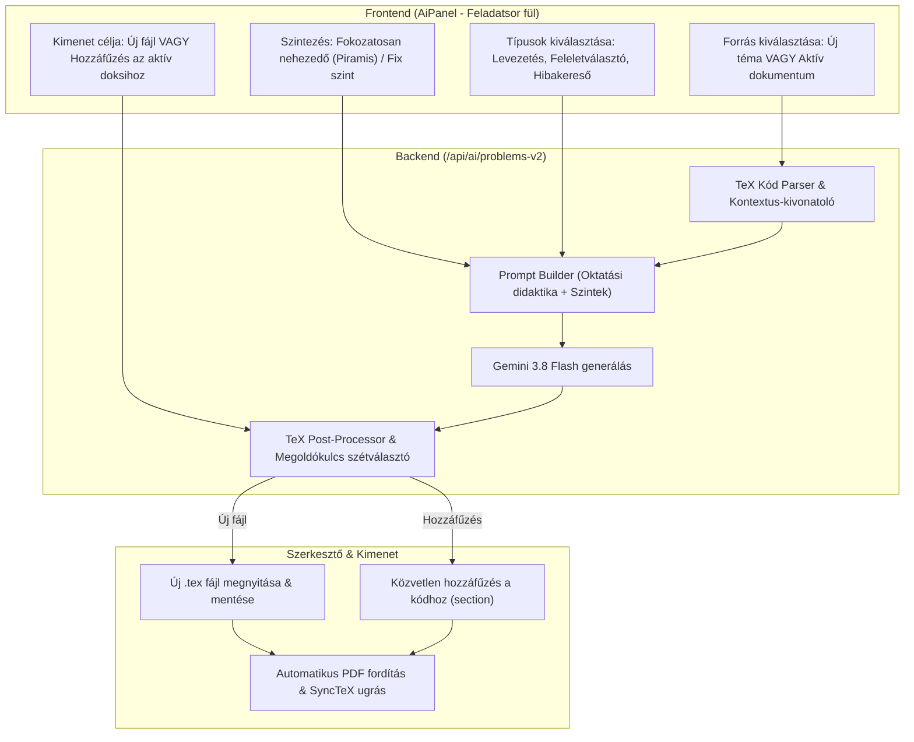

# AI Feladatgenerátor – Részletes Koncepció és Fejlesztési Terv

> **Dokumentum verzió:** 1.0  
> **Célterület:** AI Asszisztens – Oktatási és Érettségi Feladatgenerálás (Matematika & Fizika)  
> **Kapcsolódó fájlok:** `frontend/src/components/AiPanel.jsx`, `backend/routes/ai.js`, `frontend/src/App.jsx`

---

## 🎯 1. Célkitűzés és Motiváció

A jelenlegi feladatgeneráló funkció egyszerű témakör-szöveget és fix nehézségi szintet használ, és mindig új dokumentumként hozza létre a feladatokat.

**A fejlesztés fő célja:**
1. **Létező dokumentumhoz kapcsolódó generálás:** Az AI képes legyen az éppen megnyitott `.tex` dokumentum (vagy egy kiválasztott fejezetének / tételének) elméletét alapul venni, és ahhoz illeszkedő feladatokat generálni.
2. **Fokozatosan nehezedő szintek (Nehézségi létra):** A feladatsor didaktikailag felépített legyen: egyszerű alapfogalmi szinttől a középszintű érettségin át az emelt szintű / gondolkodtató feladatokig.
3. **Beillesztési rugalmasság:** A generált feladatsor beilleszthető legyen az **aktív dokumentum végére** (`\section{Gyakorló feladatok}` formájában) VAGY **új dokumentumként**.
4. **Gazdag feladattípusok & Tanári segédletek:** Feleletválasztós, igaz/hamis, hibakeresős, lépésről-lépésre levezetett feladatok, részletes megoldókulccsal és magyar érettségi stílusú pontozási útmutatóval.

---

## 🏗️ 2. Architektúra és Munkafolyamat



---

## 💡 3. Részletes Funkciók és Ötletek

### 🌟 3.1. Kontextus-alapú generálás aktív dokumentumból
- **Dokumentum-kapcsolás:** Az AI panel automatikusan érzékeli az aktív fájl tartalmát és címét (`currentFile.name`, `currentCode`).
- **3 kiválasztási mód:**
  1. *Teljes dokumentum alapján:* Az AI átolvassa az elméleti összefoglalót, és annak definícióira, képleteire készít gyakorló feladatokat.
  2. *Kijelölt szövegrész alapján:* Ha a szerkesztőben ki van jelölve pl. a "Másodfokú egyenlet diszkriminánsa" vagy "Pitagorasz-tétel", az AI kizárólag a kijelölt tételre koncentrál.
  3. *Fejezetek szerint strukturálva:* Ha a dokumentumban több `\section` van, mindegyikhez arányosan generál feladatokat.
- **Kimeneti elhelyezés:**
  - `[+] Hozzáfűzés a jelenlegi dokumentum végére`: Automatikusan beszúrja: `\newpage \section{Gyakorló feladatsor}` és `\section{Megoldások}`.
  - `[📄] Új külön dokumentumként`: Létrehoz egy új fájlt (pl. `Ismétléses_permutáció_Feladatok.tex`), a jelenlegi dokumentum preambulumát felhasználva!

---

### 🧗 3.2. Fokozatosan nehezedő szintek (Nehézségi létra)
Nem csupán egyetlen nehézségi szint (könnyű/közepes/nehéz) választható, hanem **didaktikai profilok**:

| Szint kategória | Nehézség | Jellemzők | Példa (Kombinatorika) |
|---|---|---|---|
| **1. Alapozó (Drill)** | Könnyű | Definíció közvetlen alkalmazása, egyszerű számolás | 4 könyv hányféleképpen tehető fel egy polcra? |
| **2. Középszintű érettségi** | Közepes | 2–3 lépéses levezetés, tipikus szöveges kontextus | 7 fős társaság ül egy kerek asztalhoz, 2 ember egymás mellett ül |
| **3. Emelt szintű érettségi** | Nehéz | Korlátozó feltételek, esetszétválasztások, kombinált témák | Ismétléses permutáció feltételekkel (nem kezdődhet 0-val, párosnak kell lennie) |
| **4. Gondolkodtató / Verseny** | Extrém | Kreatív trükk, nem-triviális bizonyítás | Rekurzióval vagy skatulya-elvvel kombinált feladat |

#### Választható Didaktikai Profilok:
- **Piramis modell (Alapértelmezett, ajánlott):** 40% Alapozó $\to$ 40% Középszint $\to$ 20% Emelt szint.
- **Érettségi teszt modell:** I. Rész (Rövid egyszerű kérdések) + II. Rész (Hosszabb összetett feladatok).
- **Homogén szint:** Csak adott szint (pl. 8 db kizárólag emelt szintű feladat gyakorlása).

---

### 🎨 3.3. Feladattípusok Variációja (Checkbox-os választási lehetőség)
Az unalmas, egysíkú számítási feladatok helyett választható feladattípusok:

1. **Számolásos / Levezetős feladat (Klasszikus):** Részletes levezetést igénylő feladatok $a), b), c)$ alpontokkal.
2. **Feleletválasztós (Multiple Choice - A/B/C/D):** Tipikus tévesztési pontokra (distraktorokra) épülő 4 opciós kérdések.
3. **Igaz / Hamis indoklással:** Fogalmi megértést mérő kérdések, ahol a hamis állításokat ellenpéldával kell cáfolni.
4. **"Keresd meg a hibát!" (Error Spotting):** Kész levezetés, amelyben egy elrejtett hiba van (pl. hamis gyök, nullával osztás, előjelhiba). A diáknak meg kell találnia és ki kell javítania.
5. **Gyakorlati / Életszerű (Story Problem):** Hétköznapi helyzetekbe ágyazott feladat (pl. pénzügyi matek, fizikában autó féktávja, optikai műszerek).
6. **"Scaffolded" (Vezetett lépcsős) feladat:** Az $a)$ és $b)$ alpont fokozatosan rávezeti a diákot a nehéz $c)$ kérdés megválaszolására.

---

### 📋 3.4. Megoldások Elhelyezése, Pontozókulcs és Dokumentumkezelés

A feladatok megoldásainak elhelyezése 3 különböző didaktikai igény szerint állítható be:
1. **Csak a feladatsor után külön oldalra (`separate_page`):**
   - Klasszikus feladatlap/dolgozat formátum: a diák először a feladatokat látja, majd egy kötelező `\newpage` lapdobás után következik a `\section*{Részletes megoldókulcs}` tételes levezetésekkel.
2. **A feladat után rögtön a megoldás (`inline`):**
   - Tanári kidolgozott feladatgyűjtemény vagy önálló tanulási példatár formátum.
   - Minden egyes feladat szövege alatt azonnal ott szerepel a kidolgozás és levezetés egy esztétikus, kiemelt `tcolorbox` dobozban.
3. **Különálló dokumentumba (`separate_doc`):**
   - Két külön fájl készül: egy **tiszta diák feladatlap** (megoldások nélkül) és egy **teljes önálló megoldókulcs dokumentum** (`[Cím]_Megoldasok.tex`).
   - A megoldókulcs azonnal automatikusan elmentésre kerül a projekt megfelelő mappájába, frissül a fájlkezelő fastruktúra, és az AI panelben 1-kattintásos gombokkal megnyitható vagy másolható.

- **Magyar Érettségi Pontozási Útmutató (Rubric):**
  Minden feladat megoldásához tételes pontbontás társul:
  - *Képlet felírása és behelyettesítés:* 1 pont
  - *Másodfokú egyenlet megoldása:* 2 pont
  - *Szöveges feltételek ellenőrzése, válaszadás:* 1 pont
  - **Összesen: 4 pont**
- **Gyorsellenőrző sáv (Csak a végeredmények):**
  A dokumentum legvégén egy kompakt táblázat (1: 24, 2: x=3, 3: C...), amellyel a diák azonnal ellenőrizheti magát a teljes levezetés megnézése előtt.
- **Tipp / Hint dobozok:**
  Külön beállítható kis segítség dobozok ("*Tipp: Használd a kétszeres szög szinuszára vonatkozó azonosságot!*").

---

### 📐 3.5. TikZ Ábrás Feladatok Generálása
- Geometria, függvénytan vagy mechanika esetén az AI automatikusan generáljon a feladathoz illeszkedő, fordítható TikZ ábrát (pl. lejtő erővektorokkal, háromszög magasságvonallal, koordináta-rendszer grafikonnal).
- Olyan feladatok, amelyek egy megadott ábra leolvasásán alapulnak (pl. sebesség-idő grafikonról elmozdulás megállapítása).

---

### 👥 3.6. "A" és "B" Csoportos Dolgozat Generálás
- Dolgozatkészítéskor egyetlen kattintással generáljon **"A" és "B" csoportos feladatsort**:
  - A feladatok típusa, elmélete és nehézsége pontosan megegyezik,
  - de a számadatok különböznek, így a közvetlen másolás megelőzhető.
- Szabványos dolgozat-fejléc generálása: Név, Osztály, Dátum, Elérhető pontszám, Érdemjegy-határok táblázata ($0-39\% = 1$, $40-59\% = 2$, stb.).

---

### 📖 3.7. Rövid Elméleti Összefoglaló a Feladatok Előtt (Képletek, Definíciók)
- Opcionálisan bejelölhető opció: `[x] Rövid elméleti összefoglaló a feladatok előtt (képletek, definíciók)`.
- Ha be van kapcsolva, az AI a feladatsor elé egy kb. féloldalas, tömör szakaszt szúr be:
  - `\section*{Elméleti áttekintés és fontos képletek}`
  - A legfontosabb fogalmak, definíciók és tételek tcolorbox-ban vagy bullet pointokban.
  - A feladatok megoldásához nélkülözhetetlen képletek kiemelt matematikai környezetben.
  - Tipikus kikötések és feltételek (pl. értelmezési tartomány).
  - Így a feladatsor önmagában is teljes értékű tanulási segédletként használható (a diák azonnal felidézheti a képleteket a feladatmegoldás előtt).

---

## 🖥️ 4. Tervezett UI Elrendezés az AI Panelben

Az `AiPanel.jsx` "Feladatsor" (`problems`) fülének megújult kezelőfelülete:

```
┌────────────────────────────────────────────────────────┐
│  📋 FELADATGENERÁLÁS & GYAKORLÓSOR                     │
├────────────────────────────────────────────────────────┤
│  Forrás kiválasztása:                                  │
│  (•) Aktív dokumentum alapján: "Ismétléses permutáció" │
│  ( ) Teljesen új témakör megadása manuálisan          │
│                                                        │
│  [Ha aktív doksi]:                                     │
│  [x] Csak a kijelölt szövegre koncentráljon            │
│  Elméleti kivonat: 12 tétel, 4 képlet felismerve       │
├────────────────────────────────────────────────────────┤
│  Nehézségi felépítés:                                  │
│  [ 🧗 Fokozatosan nehezedő (Piramis) ▾ ]              │
│  • 2 könnyű alapszint  • 3 középszint  • 1 emelt szint │
│                                                        │
│  Feladatok száma: [-]  6 feladat  [+]                  │
├────────────────────────────────────────────────────────┤
│  Feladattípusok (összetettség):                        │
│  [x] Klasszikus levezetős feladatok                    │
│  [x] Feleletválasztós (A/B/C/D) tesztkérdések          │
│  [ ] "Keresd meg a hibát a levezetésben!"              │
│  [x] Szöveges / Gyakorlati alkalmazás                  │
│  [ ] TikZ ábrák generálása a feladatokhoz              │
├────────────────────────────────────────────────────────┤
│  Megoldások & Tanári funkciók:                         │
│  [x] Részletes levezetés és magyarázat                 │
│  [x] Érettségi pontozási útmutató (rubric)             │
│  [ ] "A" és "B" csoportos dolgozat formátum            │
├────────────────────────────────────────────────────────┤
│  Kimenet elhelyezése:                                  │
│  [ ➕ Hozzáfűzés az aktív kód végére ]                │
│  [ 📄 Generálás új dokumentumként ]                   │
│                                                        │
│  [ 🚀 Feladatsor Generálása (Gemini 3.8 Flash) ]       │
└────────────────────────────────────────────────────────┘
```

---

## 📅 5. Megvalósítási Lépések (Roadmap)

### 1. Mérföldkő: Backend bővítés (`backend/routes/ai.js`)
- [ ] Új `/api/ai/problems-smart` végpont vagy meglévő `/api/ai/problems` továbbfejlesztése.
- [ ] Paraméterek támogatása: `documentContext`, `difficultyLadder` (piramis/fix), `problemTypes[]`, `withRubric`, `appendMode`.
- [ ] Fejlett magyar érettségi stílusú Gemini 3.8 system prompt megírása szigorú LaTeX szintaxissal és megoldókulccsal.

### 2. Mérföldkő: Frontend UI frissítés (`frontend/src/components/AiPanel.jsx`)
- [ ] Forrásválasztó kapcsoló (`Aktív dokumentum` vs `Egyéni téma`).
- [ ] Didaktikai nehézségi létrák választója (`CustomSelect` opciókkal: Piramis, Alapozó, Érettségi, Emelt).
- [ ] Feladattípus jelölőnégyzetek (Checkbox csoport).
- [ ] Beillesztési cél kiválasztása (`onAppend` vs `onInsert`).

### 3. Mérföldkő: Dokumentumba illesztés és intelligens fordítás (`App.jsx`)
- [ ] Ha a felhasználó a "Hozzáfűzés a meglévő kódhoz" lehetőséget választja, a meglévő preambulum megtartásával csak a feladatsor törzse kerül beillesztésre.
- [ ] Azonnali fordítás és SyncTeX fókuszálás az új feladatsor kezdetére.
