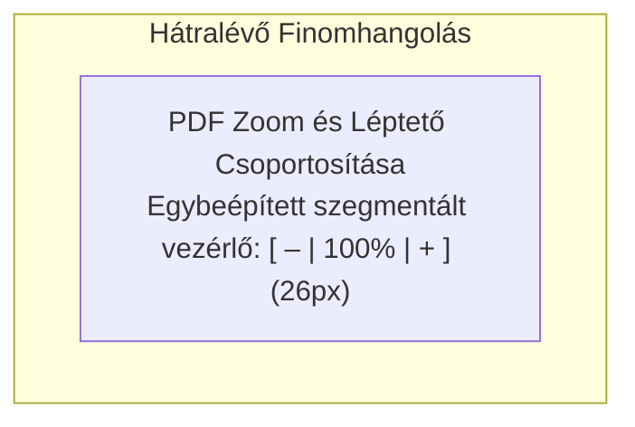

# TeXa AI Studio – UI Tisztítási és Rendszerezési Javaslat
*Aktualizált dokumentum a már megvalósított fejlesztések kivezetésével és a hátralévő finomhangolási javaslatokkal.*

---

## ✅ Már Megvalósult Eredmények

Az elmúlt fázisban sikeresen befejeztük a felület nagyszabású strukturális tisztítását és Apple Pro szintű egységesítését:

- [x] **Felső Fő Eszköztár (`Toolbar.jsx`):** Magassága 56px-ről letisztult **44px-re** csökkentve. A duplikált gombok (*Visszavonás/Újra, Új/Sablon/Importálás, PDF Letöltés*) maradéktalanul kivezetve; helyüket egy letisztult 3-zónás elrendezés vette át (Márka + Aktív fájlnév állapotjelző ponttal + Rendszerfunkciók: Preambulumok, Beállítások és Billentyűparancsok súgó).
- [x] **Oszlopfejlécek egységesítése:** Mind a 4 oszlop (*Fájlkezelő, AI Asszisztens, TEX szerkesztő, PDF előnézet*) teljesen azonos Apple-stílusú inline ikont és tipográfiát kapott.
- [x] **Metál / 3D keretes dobozok megszüntetése:** A fejléc ikonokról és a becsukott AI gombról lekerült a domború, szürke dobozos hatás; sík, modern Apple kék vonalas ikonokká váltak.
- [x] **Fájlkezelő becsukott állapota:** A korábbi generikus nyíl helyett a Fájlkezelő saját mappa ikonja (`Folder`, 16px) jelenik meg a tetején élő fájlszám-jelvénnyel, pontosan illeszkedve a becsukott AI Asszisztens ikonjához.
- [x] **Gombokon belüli vertikális középre igazítás:** A fejlécgombok és ikonok pixelpontos matematikai középre igazítást kaptak (`26×26px`, flexbox, `line-height: 0`), megszüntetve a hover állapotban korábban látható aszimmetriát.
- [x] **Fájlkezelő 28px kompakt szegmentált akciógombok (`Sidebar.jsx`):** A korábbi két sorba tördelt akciógombok helyett egyetlen egybeépített 28px-es szegmentált vezérlő jött létre: `[ + Üres ] [ ⊞ Sablon ] [ ⤒ Import ]`, ami közvetlenül a keresőmező fölé került, felszabadítva +36px vertikális helyet a fájlfa javára.
- [x] **Alsó Állapotsor (`StatusBar` – 26px, 3 zónás elrendezés):** Szigorúan 26px magas, alacsony kontrasztú, csendes sáv:
  - *Bal zóna:* Munkamappa ikon és név (kattintásra helyi mappaválasztó / beállítások).
  - *Közép zóna:* Valós idejű fordítási státusz, idő és időtartam (pl. `Lefordítva (0.8s) · 21:40`).
  - *Jobb zóna:* Hasznos gyorsbillentyű-súgó (`⌘S: Fordítás · ⌘B: Fájlkezelő · ⌘K: AI`).
- [x] **Modern LLM Csevegő Beviteli Mező (`AiPanel.jsx`):** A Claude / ChatGPT / Gemini mintájára a különálló alsó gombsáv megszűnt. A képcsatolás közvetlenül a szövegmező aljába, a küldés pedig egy elegáns kék kör alakú `ArrowUp` gombba integrálódott (+30px extra hely a chat-üzeneteknek). Az űrlap elemek magassága egységesen 32px Apple-szabvány lett.
- [x] **Hiba Konzol automatizálása (`EditorPane.jsx`):** Alapértelmezetten rejtve/összecsukva marad (34px-es diszkrét sávként), így a kódterület 100%-os magasságot kap. Fordítási hiba esetén azonnal automatikusan felnyílik (160px) valós idejű loggal és a fejlécbe épített 1-kattintásos **„Hiba javítása AI-val”** gombbal, majd sikeres javítás után magától visszacsukódik.
- [x] **PDF Eszköztár tisztítás:** Az önálló „AI Beszúrás” gomb kivezetve; a funkció az Átszerkesztés kijelölési modaljában érhető el tisztán.
- [x] **TikZ Mini-Előnézet & Finomhangoló Sáv Egységesítése és Tömörítése (`AiPanel.jsx`, `index.css`):**
  - Az idegen, színes emojik (`🔍`, `🎨`, `🏁`, `🏷️`, `➕`, `🎯`, `📄`, `📦`, `↔️`, `🔹`) maradéktalanul lecserélve a felület egységes, professzionális Lucide ikonjaira (`ZoomIn`, `ZoomOut`, `Palette`, `Contrast`, `Type`, `MoveRight`, `Crosshair`, `ArrowDownToLine`, `Image`, `AlignCenter`).
  - A fejléc cím lerövidítve (`TikZ előnézet`), megszüntetve a csúnya kétsoros törést.
  - A korábbi 3 soros, ormótlan finomhangoló chipek kompakt, 22px magas egységes raszterbe kerültek.
  - A szegmentált vezérlők (*Pozíció*, *Környezet*) a modern Apple sötét stílust kapták (`#636366` aktív háttérrel).
  - Az alsó akciógombok feliratai tömörítve lettek (`Beszúrás & Fordítás`, `+ Önálló fájl`, `Másolás`), így még keskeny panelszélességnél sem vágnak le és nem folynak túl a kereten.
  - A canvas előnézeti magassága ésszerűbb keretek közé került (`max-height: 250px`), hogy a vezérlők kényelmesen elférjenek a képernyőn.
- [x] **Szerkesztő Fejléc Letisztítása (`EditorPane.jsx`):**
  - A duplikált `TOC javítása` gomb kikerült a szerkesztő fejlécéből, mivel a funkció közvetlenül és természetesen a Vázlat panel megnyitásakor érhető el (`DocumentOutline.jsx`).
  - Az Overleaf téma váltó gomb felirata (`Overleaf Sötét / Világos`) lekerült, mostantól csak a tiszta ikon (`Sun` / `Moon`) látható, jelentős helyet spórolva a fejlécben.
- [x] **Fájl és Mappa Átnevezés Teljes Szélességű Mezeje (`Sidebar.jsx`, `index.css`):** Átnevezéskor a többi funkcióikon (*áthelyezés, átnevezés, címke, törlés, számláló*) azonnal elrejtőzik, így a szöveges beviteli mező a teljes sorszélességet (100%) kitölti, és a hosszú fájlnevek is kényelmesen, levágás nélkül szerkeszthetőek.
- [x] **Fájlfa Térközök Egységesítése (`Sidebar.jsx`, `index.css`):** Megszüntettük az almappák közötti korábbi 14px-es alsó margót (`.folder-group.subfolder-group`). A mappák és fájlok közötti vertikális távolság mostantól minden szinten egységesen és szabályosan a standard 2px-es rasztert követi, megszüntetve a fájlok és az almappák (pl. a `Feladatsor`) közötti szokatlan hézagot.
- [x] **Dokumentum Statisztika Áthelyezése az Állapotsorba (`EditorPane.jsx`, `App.jsx`):** A szerkesztő fejlécéből a zavaró `293 sor · 12248 kar.` pill átkerült a modern fejlesztői környezetek (VS Code, Overleaf, Sublime, Xcode) szabványos helyére, az **alsó Állapotsor (Status Bar)** jobb oldalára a gyorsbillentyűk mellé. Ezzel a TeX szerkesztő fejléce teljesen letisztult és szellős lett.
- [x] **TEX szerkesztő Oszlopcímének Láthatósága (`EditorPane.jsx`, `index.css`):** Kivezettük a korábbi agresszív `@container (max-width: 880px)` szabályt, amely 880px panelszélesség alatt elrejtette a címet. A „TEX szerkesztő” oszlopcím mostantól a Fájlkezelőhöz és az AI Asszisztenshez hasonlóan mindig tisztán látható. Extrém keskeny oszlopméretnél (380px alatt) elegánsan a rövidített „TEX” formátumra vált, és csak 300px alatt redukálódik ikonra.
- [x] **PDF előnézet Oszlopcímének Láthatósága (`PdfPreview.jsx`, `index.css`):** Megszüntettük a 660px-es konténer-szabályt, amely a normál elrendezésben levágta az oszlopcímet „PDF”-re. A fejléc mostantól teljes szövegével (**„PDF előnézet”**) jelenik meg a normál munkaterületen, pontosan illeszkedve a többi 3 oszlopfejléchez („Fájlkezelő”, „AI Asszisztens”, „TEX szerkesztő”). Csak 380px alatt rövidül, és 300px alatt redukálódik ikonra.
- [x] **Saját Dokumentumtípusok & Sablonok Modál Teljes Áttervezése (`CustomDocTypesModal.jsx`, `index.css`):**
  - **Unstyled fehér négyzetgombok megszüntetése:** A korábbi stílusozatlan, fehér hátterű szerkesztés (`🖊`) és törlés (`🗑`) gombok helyére Apple-stílusú sötét üveg ikonvezérlők (`doc-action-icon-btn`) kerültek finom hover és törlés-kiemelési effekttel. Globálisan is levédtük a `.btn-icon` definíciót.
  - **Tantárgy szűrő egységes sáv:** A korábbi rikító kék ovális pill és a láthatatlan szövegek helyett egybeépített, elegáns 28px-es Apple szegmentált vezérlősáv jött létre ikonokkal (`Sigma`, `Atom`, `Layers`).
  - **Kiválasztás akciógombok differenciálása:** Az összes kártyán egyformán harsány kék gombok helyett az aktív sablon zöld pipás `Kiválasztva` állapotot kapott, míg az egyéb kártyák letisztult kék gombbal rendelkeznek.
  - **Összecsukható AI utasítás előnézet:** A nehezen olvasható, fix magasságú, nyers monospace prompt-doboz helyett diszkrét fejlécet kapott (`✨ AI UTASÍTÁS & FELÉPÍTÉS`), kompakt 2-soros áttekintéssel és egy kattintással lenyitható `[ Részletek ▾ ]` kibontási lehetőséggel.
  - **Egységes tipográfia és címkék:** A `Mintasablon`, `Saját mentett` és a tantárgyjelvények összehangolt dizájnt és ikonokat kaptak.
- [x] **Feladatsor Forrásválasztó Tisztítás & Intelligens Témakör-felismerés (`AiPanel.jsx`):** A mesterséges 3-opciós kapcsoló (`[ Téma ] [ Aktuális fájl ] [ Könyvtár ]`) megszűnt. A felszabadult helyet a Könyvtár csatolt forrásfájl dropzone-ja és kártyalistája kapta meg közvetlenül. Ha vannak fájlok csatolva vagy van megnyitott `.tex` dokumentum, az AI intelligensen felismeri és előre kitölti a `Témakör` mezőt (a cím, fejezet vagy fájlnév alapján), ami továbbra is 100%-ban szabadon szerkeszthető és a `[ ✨ Felismerés ]` gombbal bármikor újrafuttatható.

---

## 🎯 Hátralévő Nyitott Javaslat (Teendő)

A felületen már csak egyetlen fókuszált finomhangolás maradt hátra:

---

### PDF Előnézet Zoom és Léptető Csoportosítása (`PdfPreview.jsx`)

**Jelenlegi állapot:**
A PDF előnézet fejlécében a Zoom gombok (`-`, `100%`, `+`) és az oldalváltó különálló gombokként terülnek el, ami kisebb monitorokon vagy keskenyebb panelméretnél összeérhet a többi gombbal.

**Javaslat:**
- A Zoom gombokat egyetlen egybeépített, szegmentált csoporttá alakítani:
  `[ – | 100% | + ]` (26px magasság, Apple üveg stílus).
- Keskeny PDF oszlopméret esetén a zoom/oldalváltó lebegő alsó diszkrét lebegő sávvá (HUD) válhat, ahogyan a macOS Preview vagy a Safari PDF nézet csinálja.
- **Előny:**
  - A felső PDF fejléc rendezett marad, a legfőbb akciógomb (*▶ PDF Fordítás*) megőrzi kiemelt pozícióját.
